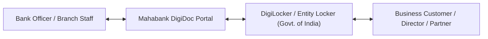
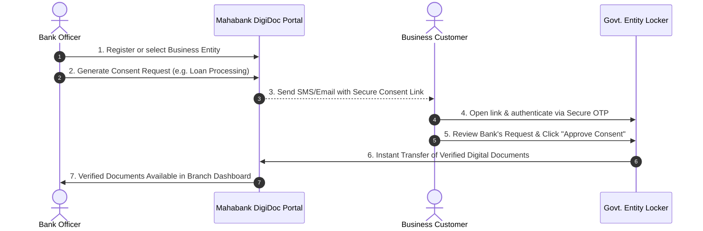
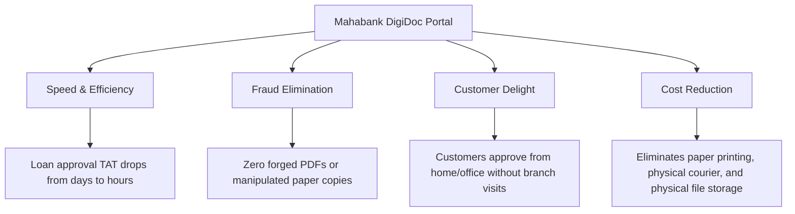

# Bank of Maharashtra — DigiDoc Portal & Entity Locker Integration
## Business Overview & Operational Workflow Guide

---

## 1. Executive Summary

The **Mahabank DigiDoc Portal** is Bank of Maharashtra’s next-generation digital document retrieval and verification platform. It provides bank officers with a 100% digital, paperless, and tamper-proof system to collect verified official documents from commercial entities (businesses, companies, MSMEs, partnerships, and sole proprietors).

The portal connects directly with **Entity Locker** (part of Government of India’s **DigiLocker** ecosystem designed specifically for businesses and enterprises).

Instead of asking business customers to courier physical papers, bring photocopied folders to branches, or email insecure PDFs, the portal allows bank officers to send a digital consent request. Once the business owner approves the request via OTP on the official government portal, authentic and tamper-proof documents are instantly and securely transferred to the bank.

---

## 2. The Problem It Solves: Before vs. After

| Challenge Area | Traditional Manual Banking Process | Mahabank DigiDoc Portal Solution |
| :--- | :--- | :--- |
| **Document Sourcing** | Customer physically visits branch with xerox copies or sends unverified email attachments. | Instant digital delivery directly from the Government’s verified source repository. |
| **Document Authenticity** | High risk of altered statements, counterfeit certificates, or fraudulent tax filings. | 100% authentic and digitally signed; zero chance of tampering or manipulation. |
| **Turnaround Time (TAT)** | 5 to 15 days spent chasing customers, collecting missing pages, and certifying copies. | Reduced to **minutes**: once customer approves via OTP, documents arrive immediately. |
| **Customer Experience** | Repetitive visits, stressful paperwork, and delays in loan sanctioning. | One-click digital approval from anywhere on any smartphone or computer. |
| **Compliance & Audit** | Loose paper files in branch storage; difficult to track who accessed what. | Automated, time-stamped digital audit logs detailing every single consent and document access. |

---

## 3. Key Participants in the Ecosystem

1. **The Bank Officer (Requester):**
   * Branch managers, credit officers, or loan processing team members who need business documents to process loan applications, complete periodic KYC reviews, or open current accounts.
2. **The Business Customer (Entity):**
   * The authorized signatory, director, partner, or proprietor of a company who holds an official Entity Locker account.
3. **Entity Locker / DigiLocker Platform:**
   * The sovereign government repository managed by Digital India / NeGD that safely stores issued company records (GST certificates, PAN, Incorporation papers, verified bank statements, and tax filings).
4. **Mahabank DigiDoc Portal:**
   * The central banking interface that orchestrates the request, manages customer consent lifecycles, and organizes documents neatly in a secure digital vault for bank officers.

---

## 4. End-to-End Business Flow (How It Works)

The entire operation follows a simple, transparent **6-step workflow**:

### Detailed Breakdown of the Steps:

#### Step 1: Entity Identification & Registration
* The bank officer opens the portal and searches for the business by name or Entity ID.
* If the business is new to the portal, the officer performs a one-time entry of basic details:
  * Company / Business Name (e.g., *ABC Textiles Pvt Ltd*)
  * Business Type (e.g., Private Limited, Partnership, Sole Proprietorship)
  * Authorized Person’s Name, Mobile Number, and Email

#### Step 2: Initiating the Document Request
* The officer selects the purpose of the request:
  * *Loan Application Processing*
  * *Periodic KYC Refresh*
  * *New Account Opening*
  * *Credit Monitoring*
* The officer sets the validity period for the consent (e.g., valid for 7 days or 30 days).

#### Step 3: Customer Notification
* The portal generates a unique, tamper-proof, bank-branded authorization link.
* An automated notification (SMS / Email) is dispatched to the authorized business representative explaining:
  > *"Bank of Maharashtra has requested digital access to your verified business documents for Loan Processing. Please click the link to review and grant consent."*

#### Step 4: Customer Consent Approval
* The business customer clicks the link on their mobile device or desktop.
* They are taken to the official, secure Government of India Entity Locker portal.
* The customer logs in using their own credentials and confirms identity via two-factor OTP.
* The screen clearly displays:
  * Who is requesting (Bank of Maharashtra)
  * What documents are being requested (GST, PAN, Incorporation, Statements)
  * How long the consent will remain active
* The customer clicks **"Approve Consent"**.

#### Step 5: Secure Document Retrieval
* The moment consent is granted, the government platform notifies the bank portal.
* The portal securely pulls the official, digitally signed documents directly into the bank's secure repository.
* Documents are automatically indexed by type, issuance date, and entity ID.

#### Step 6: Verification & Final Action
* The bank officer sees the status instantly update from **Pending** to **Authorized / Verified**.
* The officer can preview, inspect, or download the original PDF documents with full confidence that every page is 100% authentic.

---

## 5. Main Modules of the Portal

### 1. Unified Dashboard & Executive Analytics
* **Overview Summary:** Real-time counters showing total registered entities, active consent links, pending requests, and verified documents.
* **Monthly Trends:** Visual charts showing the volume of loan documents processed across months.
* **Role-Based Visibility:**
  * **Branch Officers** see only data for their specific branch.
  * **Branch Managers** monitor branch-wide performance and officer productivity.
  * **Head Office / Central Administrators** see bank-wide national statistics across all regions and branches.

### 2. Requester Hub
* **Entity Directory:** A searchable master list of all commercial clients registered with the bank for digital document sharing.
* **Request & Link Tracker:** Live status tracking for every customer link sent:
  * *Pending:* Customer hasn't acted yet (allows 1-click resend/reminder).
  * *Authorized:* Customer granted access; documents ready.
  * *Expired:* Validity ended; protects customer privacy.
  * *Revoked / Rejected:* Customer declined access.
* **Digital Document Vault:** Dedicated file viewer for inspection of:
  * Government-issued certificates (PAN, GST registration, Udyam MSME certificate, Company CIN/MOA).
  * Self-uploaded documents submitted by the business.
  * Verified bank statements.

### 3. User & Role Management
* Controlled administrative module enabling the bank to manage internal staff access:
  * Add branch officers and assign them to specific branch codes (e.g., Pune Main Branch, Mumbai Branch).
  * Assign privileges based on hierarchy (Administrator, Branch Manager, Officer).
  * Protect system security by preventing accidental deactivation of active managers.

---

## 6. Privacy, Security & Regulatory Compliance

> [!IMPORTANT]
> The Mahabank DigiDoc Portal is built around the fundamental principle of **Customer-Centric Consent**. No bank officer can view or download any document without the customer’s explicit, time-stamped digital approval.

1. **Explicit Customer Consent (Zero Unauthorized Access):**
   * The customer retains 100% control. The bank cannot "pull" files unilaterally; the customer must log into their own DigiLocker/Entity Locker and approve the transfer.
2. **Time-Bound Validity:**
   * Every consent has an expiry date. Once expired, the bank’s access automatically terminates unless renewed by the customer.
3. **Tamper-Proof Authenticity:**
   * Because documents originate directly from government issuers (Ministry of Corporate Affairs, Income Tax Department, GSTN), there is zero risk of forged paper documents or manipulated balances.
4. **Comprehensive Audit Logs:**
   * Every action taken within the system—when a request was created, when the link was opened, when consent was granted, and when an officer viewed a document—is recorded with date, time, and IP address for internal vigilance and RBI audits.
5. **Bank-Grade Data Protection:**
   * All communication between the bank, the customer, and the government platform is encrypted using industry-standard enterprise security protocols.

---

## 7. Business Benefits for the Bank

* **Faster Loan Disbursements:** Drastically cuts down turnaround time (TAT) for MSME, corporate, and retail loans.
* **Zero Document Fraud:** Eliminates fake salary slips, fabricated financial records, and manipulated tax filings.
* **Operational Cost Savings:** Drastically lowers physical storage costs, courier expenses, and manual paper-handling time.
* **Enhanced Customer Satisfaction:** Offers modern, frictionless, digital banking that respects the business customer's time.

